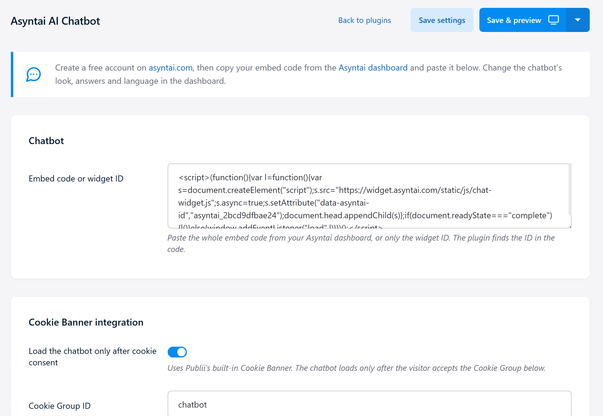

# Asyntai AI Chatbot for Publii

Add an AI chatbot to your Publii website. [Asyntai](https://asyntai.com) reads your website and answers your visitors' questions around the clock, in their own language. When a visitor wants a reply from you, the chatbot collects their email address.

## Features

- AI answers from the content of your own website
- Shows on every page of your Publii site
- Paste the embed code from your Asyntai dashboard, or only the widget ID
- Optional: loads only after cookie consent, through the Cookie Banner built into Publii
- The page never waits for the chatbot: it loads after the page has finished loading
- Change the look, the AI instructions and the languages in your [Asyntai dashboard](https://asyntai.com/dashboard)
- Works on the free Asyntai plan

## Installation

1. Download `asyntai-ai-chatbot.zip` from the [latest release](https://github.com/asyntai/publii-ai-chatbot/releases/latest).
2. In Publii, open the menu in the top right corner and choose **Plugins**. Click **Install plugin** and select the zip file.
3. Open your website, go to **Plugins** in the sidebar and turn on **Asyntai AI Chatbot**.
4. Create a free account on [asyntai.com](https://asyntai.com/auth/), then copy the website code from the Install page of your dashboard.
5. Open the plugin **Settings**, paste the code into **Embed code or widget ID** and click **Save settings**.
6. Click **Sync your website**. The chat button appears in the corner of your live site.

## Cookie consent

1. In **Site settings**, open the Cookie Banner settings and add a Cookie Group, for example with the ID `chatbot`.
2. In the plugin settings, turn on **Load the chatbot only after cookie consent** and enter the same Cookie Group ID.
3. Save and sync your website.

## Requirements

- Publii 0.40 or newer
- An Asyntai account (the free plan is enough)

## Documentation

[asyntai.com/documentation/integrations/publii/](https://asyntai.com/documentation/integrations/publii/)

## Support

Email [hello@asyntai.com](mailto:hello@asyntai.com).

## License

GPL-3.0
